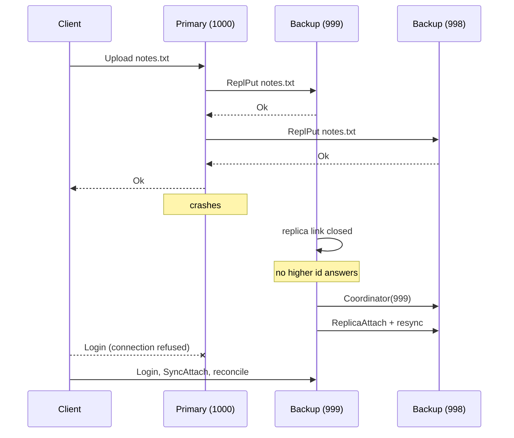

# SisOp2: a Dropbox-like file sync service

A small Dropbox clone in C++17 for Linux, originally written for an Operating Systems II (distributed systems) course.

Each user gets a `sync_dir` folder. Whatever is created, changed or deleted there is sent to a server and copied to the user's other session. The server side is **replicated**: backup servers hold copies of every file. If the primary server dies, a backup is elected to take over, and clients move to it on their own.

> [!NOTE]
> This is a rewrite (October 2026) of the original 2023 assignment, which had serious bugs. They are listed in **[docs/AUDIT.md](docs/AUDIT.md)**, with how each one was resolved. The original code is still in the git history (branch `final`).

- [Quick start](#quick-start)
- [Using it](#using-it)
- [How it works](#how-it-works)
- [Testing](#testing)
- [Limitations](#limitations)

---

## Quick start

You need Linux (or WSL) and g++ 9 or newer.

```bash
make
```

This builds `build/server` and `build/client`. Then start a server in one terminal:

```bash
./build/server
```

And a client in another, logging in as `alice`:

```bash
./build/client alice 127.0.0.1 4000
```

Anything you put in `./sync_dir` now reaches the server. A second `alice` session, started from another directory or another machine, gets it automatically.

---

## Using it

### Client

```bash
./build/client <username> <server_host> <server_port> [sync_dir]
```

- **Username:** letters, digits, `_` and `-`, up to 32 characters. There are no passwords; a new username is created on first login.
- **Sessions:** each user can have **two** sessions at a time.
- **Sync directory:** `sync_dir` defaults to `./sync_dir` and is created if it doesn't exist. Only regular files at its top level are synced; subdirectories are ignored.
- **State file:** the client keeps its sync state in `sync_dir/.sisop_state`. Files whose names start with `.sisop` are never synced.

When the client starts, it **reconciles** `sync_dir` with the server instead of overwriting either side. Changes made while the client wasn't running are applied in the right direction:
- files created or edited offline are uploaded;
- files deleted offline are deleted on the server;
- files changed elsewhere meanwhile are downloaded.

After that, every change is synced as it happens.

Commands, typed into the client's terminal:

| Command | What it does |
|---|---|
| `upload <path>` | Sends any file to the server. It then appears in every session's `sync_dir`, including this one's. |
| `download <file>` | Copies a file from the server into the current directory. |
| `delete <file>` | Deletes a file on the server and in every session's `sync_dir`. |
| `list_server` | Lists your files on the server (name, size, modification time). |
| `list_client` | Lists the files in your `sync_dir`. |
| `sync` | Runs the reconciliation again; `get_sync_dir` does the same. |
| `help` | Shows the commands. |
| `exit` | Logs out and quits. Ctrl+D (end of input) does the same; Ctrl+C just quits, and the server notices. |

**Conflicts:** if a file was modified on two sides before they could sync (say, edited on a laptop that was offline), neither edit is lost. The server's version keeps the name, and the local one is saved next to it as `notes (conflicted copy 2026-10-20 14.03.07).txt`, which then syncs like any other file.

### Server

```bash
./build/server [--port PORT] [--host HOST] [--data DIR] [--join HOST:PORT]
```

| Option | Meaning |
|---|---|
| `--port` | Port to listen on. Default: 4000. |
| `--host` | The address other servers and clients should use to reach this server. Default: `127.0.0.1`, which is enough on one machine; on several machines, set it to this machine's IP or hostname. |
| `--data` | Where files are stored, as `DIR/users/<username>/<file>`. Default: `server_data_<port>`. |
| `--join` | Join an existing cluster as a backup, by giving the address of any of its servers. Without it, the server starts a new cluster and is its primary. |

Set `SISOP_LOG=debug|info|warn|error` to change how much the server (default `info`) or client (default `warn`) logs to stderr.

### A replicated cluster

Three servers on one machine:

```bash
./build/server --port 4000
```

```bash
./build/server --port 4001 --join 127.0.0.1:4000
```

```bash
./build/server --port 4002 --join 127.0.0.1:4000
```

Clients can connect to any of them; backups redirect them to the primary. Every file is stored on all three servers.

If you stop the primary (port 4000), the backup that joined first (4001) takes over within a few seconds. Connected clients reconnect to it on their own and keep syncing. A server can join later through any member, and it receives a copy of every file when it joins.

On several machines, give each server its own `--host`:

```bash
./build/server --host 10.0.0.2 --join 10.0.0.1:4000
```

---

## How it works

### Layout

| Path | Contents |
|---|---|
| `common/protocol.*` | Message types, the frame format, `Writer`/`Reader` for payloads. |
| `common/connection.*` | `Connection`: one TCP connection with thread-safe sending, receive timeouts and request/reply helpers. |
| `common/net.*` | Connecting (with name resolution and a timeout), listening, address parsing. |
| `common/files.*` | Name validation, hashing, directory listing, and streaming a file over a connection. |
| `common/log.*` | A small thread-safe logger. |
| `server/server.*` | Accepts connections and serves client requests. |
| `server/sessions.*` | Logged-in sessions (at most two per user). |
| `server/storage.*` | Files on disk, with atomic updates. |
| `server/cluster.*` | Replication, failure detection and leader election. |
| `client/client.*` | Connection handling, reconciliation, the commands. |
| `client/sync_state.*` | The record of what was last in sync. |
| `client/watcher.*` | inotify on `sync_dir`. |
| `tests/` | End-to-end tests. |

### Protocol

Everything travels as **framed messages** over TCP. Each message is an 8-byte header followed by its payload, all in network byte order:

```
uint16 type | uint16 reserved | uint32 payload length | payload ...
```

Payload fields are written by `Writer` and read by `Reader`: fixed-size integers, plus strings as a length followed by the bytes. A malformed payload or a frame announcing more than 1 MB closes the connection.

Files are streamed rather than packed into fixed-size packets:
1. a header message carrying the name, size and modification time;
2. any number of `FileData` messages of up to 64 KB each;
3. `FileEnd`.

If the sender can't read the file to the end, it sends `FileAbort` and the receiver discards what it got. Received files are written to a temporary file and **renamed** into place, so a reader never sees a half-written file.

All message types are listed, with their payloads, in `common/protocol.hpp`.

### Connections and sessions

Each client opens **two connections** to the primary:

- **Command connection.** It starts with `Login`, and the reply carries a random session token plus the list of servers in the cluster. From then on it carries request/reply exchanges, one at a time: `ListFiles`, `Upload`, `Download`, `Delete`, `Ping`, `Logout`.
- **Sync connection.** It starts with `SyncAttach(token)`. After that only the server talks on it, pushing the changes made by the user's other sessions (`PushFile`, `PushDelete`) and updates to the server list.

The server runs one thread per connection. The first message on a connection says what it is: a client login, a sync connection, or a message from another server. Sessions end on `Logout`, when either connection closes, or after 30 s of silence (clients ping every second).

### Synchronization

The client compares **content hashes**, not filesystem events, to decide what to do. It keeps a record of every file as it was at the last successful sync: size, modification time and hash. That record is saved in `sync_dir/.sisop_state`.

- **Watching:** the watcher reports names, using `IN_CLOSE_WRITE`, `IN_MOVED_TO`, `IN_MOVED_FROM` and `IN_DELETE`, so files are reported once they're fully written. The worker thread then compares the file with the record:
  - it uploads the file if the content differs;
  - it deletes it on the server if the file is gone but the record has it;
  - it does nothing if they match.

  This makes duplicate events and the client's own downloads harmless. Downloads update the record **before** renaming the file into place, so the resulting event is recognized as nothing to do.
- **Pushes:** changes pushed by the server are written to a temporary file and moved in the same way.
- **Reconciliation:** this runs after every (re)connection. It's a three-way comparison of each file between the local copy, the server's copy and the saved record:

  | Situation | Result |
  |---|---|
  | Same content on both sides | nothing to do |
  | Changed (created, modified or deleted) on one side only | applied to the other side |
  | Modified on both sides | the server's version is kept and the local one becomes a conflicted copy |
  | Modified on one side, deleted on the other | the file is kept |

- **Who gets a change:** an upload or delete from the folder watcher is pushed to the user's *other* sessions. One from an explicit `upload` or `delete` command is pushed to *all* of them, including the one that issued it.

### Replication and failover

The servers form a **primary-backup** cluster. Clients only talk to the primary. For every change, the primary:
1. applies it locally;
2. copies it to every backup over a persistent **replica link**, waiting for each backup to confirm;
3. only then acknowledges the client.

So any change a client was told succeeded is on every live server. Changes are serialized by a write lock, which means backups apply them in the same order as the primary.

- **Joining:** a new server contacts any member (`Join`). If that member is a backup, it redirects the newcomer to the primary. The primary assigns an id, opens a replica link to the newcomer, compares both servers' file lists (name and hash), and sends whatever is missing or different, deleting what shouldn't be there. Finally it tells every server and client about the new member.
- **Failure detection:**
  - The primary sends a heartbeat on each replica link every 500 ms; a backup whose link fails is dropped.
  - A backup that loses its link, or hears nothing for 3 s, suspects the primary.
- **Election (bully algorithm):** the suspicious backup sends `Election` to every server with a higher id.
  - If one answers, that one takes over the election.
  - If none answers, the backup becomes the primary. It announces itself with `Coordinator` and opens replica links to everyone, which also brings any backup that missed a change up to date.
- **Ids:** the first server gets id 1000, and each newcomer gets a lower id than everyone before it. That keeps the primary at the highest id, which is the invariant the bully algorithm relies on. A backup that wrongly suspects a live primary always asks it during the election, so a second primary isn't elected. When the primary does die, the backup that joined first takes over.
- **Clients:** when a client loses its connection (closed socket, failed request, or a ping unanswered for 3 s), it tries every server it knows of, newest primary candidate first, and follows redirects. Once logged in again, it reconciles `sync_dir`, which covers anything that changed during the switch.



### Threads and locking

- **Server:**
  - one thread per connection, plus the cluster monitor (heartbeats and suspicion);
  - `write_mutex_` serializes changes to storage and their replication;
  - each replica link has a transaction lock;
  - the cluster's own state has a mutex, which is never held while doing network I/O;
  - locks are always taken in that order.
- **Client:**
  - **main** reads commands;
  - **supervisor** owns the connection (login, reconcile, pushes, pings, reconnects);
  - **worker** syncs local changes;
  - **watcher** runs inotify.

  The command connection is used by one exchange at a time (`cmd_mutex_`). The sync state and the files in `sync_dir` are guarded by `sync_mutex_`.
- **Each connection** has a single reader. Senders hold its send lock for a whole message, or for a whole file transfer.

---

## Testing

```bash
make test
```

This runs `tests/integration.sh`. It starts real servers and clients on random local ports and checks, among other things:
- sync between sessions, including a 3 MB file, names with spaces and empty files;
- that each change is uploaded exactly once and never bounces back;
- every command;
- changes made while a client was offline, and conflicting edits;
- the session limit;
- a client crash, which must leave the server idle and free the session;
- invalid names and paths sent straight to the server (`tests/bad_requests.py`, needs python3);
- a server restart;
- replication, failover with clients moving to the new primary, and a server joining through a backup.

It takes about 15 seconds. Run it with `KEEP=1` to keep the logs and data directories afterwards.

The suite has also been run under ThreadSanitizer, AddressSanitizer and UndefinedBehaviorSanitizer with no reports. GCC 11's TSan needs a small shim for `pthread_cond_clockwait`, which it doesn't intercept; without it, it reports false races in `condition_variable::wait_for`.

---

## Limitations

This is a teaching prototype:

- **Security:** no authentication and no encryption. Anyone who can reach the server can log in as anyone.
- **Folder structure:** only files at the top level of `sync_dir` are synced; subdirectories are ignored.
- **Transfers:** files are sent whole. There are no deltas and no resuming of interrupted transfers; a transfer that fails is simply redone.
- **Scale:** servers hash every file of a user for each listing, and for each reconciliation. That's fine for small folders, but slow for very large ones.
- **Replication cost:** replication is synchronous, so a slow backup slows uploads down. While a backup is being brought up to date (joining, or after an election), changes wait.
- **Partitions:** there is no quorum or fencing. If the network splits the servers into groups that can't see each other, each group can elect its own primary. The design handles crashes, not partitions.
- **Sessions:** sessions live in memory on the primary. After a failover, clients log in again (automatically); files aren't affected.
