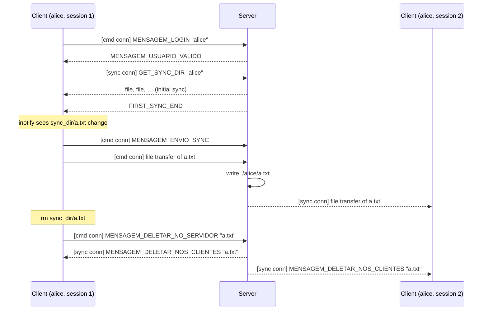

# SisOp2: a Dropbox-like file sync service

University assignment for Operating Systems II (distributed systems): a minimal Dropbox clone written in C++ for Linux.

Each user has a `sync_dir` folder on one or two machines. Whatever is created, changed or deleted there is sent to a central server and pushed to the user's other session. A second phase added **server replication**: backup servers, a heartbeat, leader election, and an attempt at moving clients to the new primary.

> [!WARNING]
> This is a student prototype and has serious bugs, including ones that let any client crash the server or delete its data. Don't run it anywhere that matters. See **[docs/AUDIT.md](docs/AUDIT.md)** for the full list and how to fix each one.

> [!IMPORTANT]
> **Which branch to use:** the most complete version is the **`final`** branch (2023-03-23). It has replication and builds as-is. **`main` currently doesn't compile.** An April 2026 merge brought in an older copy of the server code; the fix is described in the audit ([B1](docs/AUDIT.md#b1-main-does-not-compile)). The rest of this README describes both versions and notes where they differ.

---

## Contents

- [Repository layout](#repository-layout)
- [Building](#building)
- [Running](#running)
- [Client commands](#client-commands)
- [How it works](#how-it-works)
  - [Connections](#connections)
  - [Packet format](#packet-format)
  - [File transfer](#file-transfer)
  - [Message types](#message-types)
  - [Sessions](#sessions)
  - [Client threads](#client-threads)
  - [Server threads](#server-threads)
  - [Replication and leader election](#replication-and-leader-election)
  - [Client reconnection](#client-reconnection)
- [Limitations](#limitations)

---

## Repository layout

| Path | What it is |
|---|---|
| `server/server.cpp`, `server.hpp` | Server: accept loop, per-client threads, replication and election. |
| `client/client.cpp`, `client.hpp` | Client: login, command loop, receiving pushed updates, heartbeat. |
| `common/common.cpp`, `common.hpp` | Shared code: `PACKET`, (de)serialization, socket read/write, file send/receive, message type IDs. |
| `login/login.cpp`, `login.hpp` | `LoginManager`: users and their (at most 2) active sessions. Server only. |
| `filewatcher.cpp` | inotify watcher on `./sync_dir`, plus the stdin reader thread. Client only. `#include`d directly. |
| `dir_manager.cpp` | Filesystem helpers (list, delete, mkdir). `#include`d directly by client and server. |
| `sync.cpp` | Unused early draft. Not part of the build. |
| `client/sync_dir/`, `server/jp/`, `client/*.{txt,gif,mov,pdf,png}` | Test files committed during development. |
| `client/client`, `server/server`, `login/login` | Old committed Linux binaries. Rebuild instead of using these. |
| `docs/AUDIT.md` | Bug audit. |

---

## Building

Requirements: Linux (it uses inotify and POSIX sockets) and g++ with C++17. WSL works.

`dir_manager.cpp` and `filewatcher.cpp` are pulled in with `#include`, so they aren't listed on the command line:

```bash
cd server && g++ -std=c++17 server.cpp ../login/login.cpp ../common/common.cpp -lpthread -o server
```

```bash
cd client && g++ -std=c++17 client.cpp ../common/common.cpp -lpthread -o client
```

The makefiles on the `final` branch have a typo in their `-o` arguments and produce wrongly named files. Use the commands above.

---

## Running

All paths are relative to the **current working directory** of each process, so start each one from the folder where you want its data to live.

### Server

Primary server (always listens on port **4000**):

```bash
./server <bind_ip>
```

Backup server (joins an existing group):

```bash
./server <bind_ip> <existing_server_ip> <this_port> [<existing_server_port>]
```

- `<bind_ip>` must be a dotted IP address such as `127.0.0.1`. Hostnames like `localhost` aren't resolved correctly.
- A primary can't use a custom port: passing a port is what switches the server into backup mode.
- `<existing_server_port>` defaults to 4000.
- The server stores each user's files in `./<username>/`, which is created on first login.
- If you restart a server right after stopping it, it may wait up to a minute for the port to free up (no `SO_REUSEADDR`).

### Client

```bash
./client <username> <server_ip> <server_port>
```

On the `final` branch, a 4th argument is **required**: the client's own IP address, used to listen for reconnection (see [Client reconnection](#client-reconnection)):

```bash
./client <username> <server_ip> <server_port> <client_ip>
```

- There are no passwords. Any new username is created on first login.
- At most **two** sessions per user can be logged in at the same time.
- The client's extra "sync" connection always goes to port 4000, so in practice the server must be on 4000.

> [!CAUTION]
> On startup the client **deletes `./sync_dir` and recreates it empty**, then downloads the user's files from the server. Anything in `./sync_dir` that isn't on the server is lost.

---

## Client commands

Type these into the client's terminal:

| Command | What it does |
|---|---|
| *(automatic)* `get_sync_dir` | Runs once at startup: recreates `./sync_dir`, downloads everything from the server, then starts watching the folder. |
| `upload <path>` | Sends any local file to the server. The server stores it under the file's base name and pushes it to the user's synced sessions. |
| `download <name>` | Downloads `<name>` from the server into the **current directory** (not `sync_dir`). |
| `delete <name>` | Deletes `<name>` on the server and in every synced session's `sync_dir`. |
| `list_server` | Lists the user's files on the server with their timestamps. |
| `list_client` | Lists `./sync_dir` with created, modified and accessed times. |
| `exit` | Logs out and quits. Ctrl+C only sets a logout flag, which is checked the next time a command is entered. |

Files created, modified, deleted, or moved into or out of `./sync_dir` are synced automatically; you don't need a command for that. Subdirectories aren't supported. Only the top level of `sync_dir` is watched and synced.

---

## How it works

### Connections

Each client opens **two TCP connections** to the server:

1. **Command connection.** The first packet is `MENSAGEM_LOGIN`. The server creates a `ThreadClient` thread that handles requests from this client: uploads, deletes, downloads and lists.
2. **Sync connection.** It is opened right after login, and its first packet is `GET_SYNC_DIR`. The server sends every file in the user's folder, then `FIRST_SYNC_END`, and stores this socket as one of the user's sync sockets (`sync1` / `sync2`). From then on the server only **pushes** to it: files uploaded by the user's other session, and deletions.

The server's accept loop looks at (`MSG_PEEK`) the first packet of every new connection to decide what it is: a client login, a sync request, or a server-to-server message.



`MENSAGEM_ENVIO_SYNC` tells the server that the next upload came from the folder watcher rather than from `upload`, so it shouldn't be pushed back to the session that sent it.

### Packet format

Every message is one fixed-size packet, sent in host byte order (fine as long as every machine is x86/little-endian):

```c
typedef struct {
    uint16_t type;                 // message type (see table below)
    uint16_t seqn;                 // per-process counter; sent but never checked
    char     _payload[BUFFER_SIZE]; // BUFFER_SIZE = 256
} PACKET;                          // 260 bytes on the wire
```

- `readSocket` and `sendMessage` loop until all 260 bytes have been read or written.
- Text payloads (usernames, file names) are NUL-terminated strings.
- Binary payloads (file size, server id or port) are raw `memcpy`s of the value.
- Ordering and delivery are guaranteed by TCP; the `seqn` field adds nothing.

### File transfer

`sendFile` and `receiveFile` (in `common.cpp`) are used in both directions:

| # | Packet type | Payload |
|---|---|---|
| 1 | `MENSAGEM_ENVIO_NOME_ARQUIVO` | the file's path; the receiver keeps only the base name |
| 2 | `MENSAGEM_ENVIO_TAMANHO_ARQUIVO` | file size as `uint32_t` |
| 3…n | `MENSAGEM_ENVIO_PARTE_ARQUIVO` × ⌈size/256⌉ | 256-byte chunks; the last one is zero-padded |
| n+1 | `ACK` | end of file |

The receiver keeps reading parts until it sees a packet that isn't `MENSAGEM_ENVIO_PARTE_ARQUIVO`. When writing the file, it uses `size % 256` to drop the padding from the last chunk.

If the sender can't open the file, it sends `MENSAGEM_FALHA_ENVIO` instead of step 1. On the server, this path currently crashes the process ([S2](docs/AUDIT.md#s2-download-of-a-missing-file-crashes-the-server)). Files are limited to 4 GiB by the `uint32_t` size.

### Message types

Defined in `common/common.hpp`.

**Client ↔ server:**

| ID | Name | Direction | Meaning |
|---|---|---|---|
| 1 | `MENSAGEM_LOGIN` | C→S | Payload: username. First packet on the command connection. |
| 2 | `MENSAGEM_LOGOUT` | C→S | End the session. |
| 3 | `MENSAGEM_USUARIO_INVALIDO` | S→C | Login refused (user already has 2 sessions). Payload: reason. |
| 4 | `MENSAGEM_USUARIO_VALIDO` | S→C | Login accepted. |
| 7 | `MENSAGEM_VERIFICACAO` | C→S | Client heartbeat ("is the server alive?"). On `final` the server echoes it. |
| 10 | `MENSAGEM_ENVIO_NOME_ARQUIVO` | both | File transfer, step 1. |
| 11 | `MENSAGEM_ENVIO_PARTE_ARQUIVO` | both | File transfer, data chunk. |
| 12 | `MENSAGEM_ENVIO_SYNC` | C→S | "The next upload came from the folder watcher." |
| 13 | `MENSAGEM_ENVIO_TAMANHO_ARQUIVO` | both | File transfer, size. |
| 20 | `MENSAGEM_PEDIDO_LISTA_ARQUIVOS_SERVIDOR` | C→S | Request a file listing. |
| 21 | `MENSAGEM_ITEM_LISTA_DE_ARQUIVOS` | S→C | One file in the listing (name and timestamps as text). The listing ends with `ACK`. |
| 30 | `MENSAGEM_DELETAR_NO_SERVIDOR` | C→S | Delete a file on the server. Payload: name. |
| 31 | `MENSAGEM_DELETAR_NOS_CLIENTES` | S→C (sync) | Delete a file in `sync_dir`. |
| 40 | `MENSAGEM_DOWNLOAD_FROM_SERVER` | C→S | Request a file. Payload: name. |
| 41 | `MENSAGEM_FALHA_ENVIO` | both | The requested file couldn't be opened. |
| 50 | `GET_SYNC_DIR` | C→S | First packet on the sync connection. Payload: username. |
| 51 | `FIRST_SYNC_END` | S→C (sync) | Initial sync finished. |
| 60 | `ACK` | both | End-of-list / end-of-file marker, and general acknowledgement. |

**Server ↔ server** (replication):

| ID | Name | Meaning |
|---|---|---|
| 70 | `LIST_SERVERS` | Starts a server-list exchange. Followed by `SERVER_ITEM`s and an `ACK`. |
| 72 | `SERVER_ITEM` | One server's `{id, port, ip}`, sent as 4 packets. Also used to announce a new server. |
| 73 | `ID_REQUEST` | A new backup asks the primary for an id (followed by its `SERVER_ITEM` data). |
| 74 | `LIVENESS_CHECK` | Backup → primary heartbeat. The primary answers with `ACK`s. |
| 80 | `ELECTION` | Bully-algorithm election message to higher-id servers. Answered with `ACK`. |
| 81 | `ELECTED` | Broadcast by the election winner, with its `SERVER_ITEM` data. |

IDs 5 (`MENSAGEM_RESPOSTA_LOGOUT`) and 6 (`MENSAGEM_IP`) are defined but unused.

### Sessions

`LoginManager` (`login/`) keeps a `vector<USUARIO>`. Each user has two slots, and each slot holds:

- an "active" flag
- the command socket
- the sync socket
- the client's address (stored for reconnection)

Logging in fills the first free slot, or is refused if both are taken. Logging out clears the slot and closes both of its sockets. Users are never removed, and nothing is saved to disk. Server folders persist, but the user list resets when the server restarts.

### Client threads

| Thread | Function | Job |
|---|---|---|
| main | `main` | Processes the queue of file events (uploads or deletes them) and executes typed commands. |
| input | `input` (`filewatcher.cpp`) | Reads stdin lines into the shared `command` string. |
| watcher | `folderchecker` (`filewatcher.cpp`) | Polls a non-blocking inotify fd on `./sync_dir` every 20 ms and appends `(name, action)` events. |
| updates | `handle_updates` | Reads the sync connection and applies pushed files and deletions to `./sync_dir`. |
| heartbeat | `verificaServer` | Sends `MENSAGEM_VERIFICACAO` every second; on failure, waits for a server to reconnect. |

`mtx_file_manipulation` serializes access to `sync_dir` and the event queue. Files the client has just downloaded are remembered in `latest_downloads` so the watcher doesn't upload them straight back. That protection is incomplete; see [C7](docs/AUDIT.md#c7-sync-echo-loops-between-clients).

### Server threads

| Thread | Job |
|---|---|
| main (accept loop) | Accepts connections and dispatches on the first packet's type. It handles `GET_SYNC_DIR` (initial sync) and most server-to-server messages **inline**, so a slow initial sync blocks new connections. |
| `ThreadClient` (one per login) | Serves one client's command connection. Uploads are written to `./<user>/` and pushed to the user's sync sockets. |
| `answer_server_up` | On the primary: answers one backup's `LIVENESS_CHECK`s. |
| `check_main_server_up` + `timer` | On a backup: send heartbeats to the primary. If none is answered for ~0.8 s (`MAX_TIMER` × 20 ms), start an election. |
| `send_election` + `connection_timer` | Run one election round, with a timeout per contacted server. |

### Replication and leader election

- Each server gets a random id from 0 to 99. **The highest id is the primary** (bully algorithm).
- **Joining:** a new backup connects to any existing server, and the two swap server lists (`LIST_SERVERS`). The backup then asks the current primary for an id (`ID_REQUEST`). The primary assigns one and broadcasts the new server to everyone (`SERVER_ITEM`). The newcomer then starts an election, which it wins if its id is the highest.
- **Failure detection:** each backup sends `LIVENESS_CHECK` to the primary in a loop. If no `ACK` arrives within the timeout, it starts an election.
- **Election:** a server sends `ELECTION` to every server with a higher id. If one of them answers, that server takes over the election. If none does, this server broadcasts `ELECTED`. Every server that receives `ELECTED` updates who the primary is, and lower-id servers start sending heartbeats to the new primary.
- **Data replication (`final` only):** for every client connection, the primary opens a connection to each backup. It forwards the client's packets there and sends each uploaded file to every backup, so backups keep copies of user folders. On `main` there is no data replication.

Known problems with this layer are in the audit, especially [R1](docs/AUDIT.md#r1-receive_list_of_servers-only-reads-one-server), [R2](docs/AUDIT.md#r2-every-server-elects-itself-on-main) and [R4](docs/AUDIT.md#r4-backups-never-learn-about-users-so-failover-cant-restore-sessions).

### Client reconnection

This was added in PR #4, and it is incomplete.

1. When the client's heartbeat fails, the client opens a listening socket on **TCP port 2000**: on the server's IP on `main`, or on the 4th argument's IP on `final`.
2. When a server wins an election, it calls `reconnectToClients`, which tries to connect to port 2000 at every known client address.
3. The client accepts the connection and swaps it in as its command connection.

As written, this can't succeed: the new primary has no user list, it calls `connect` on the wrong socket, and nothing re-runs the login or sync handshake afterwards. Details and a simpler alternative design are in [the PR #4 review](docs/AUDIT.md#pr-4-review).

---

## Limitations

- Linux only (inotify, POSIX sockets, pthreads).
- No authentication or encryption. Usernames and file names aren't validated, which enables path traversal ([S1](docs/AUDIT.md#s1-delete--wipes-the-server), [S3](docs/AUDIT.md#s3-path-traversal-via-download-and-usernames)).
- Only the top level of `sync_dir` is synced; no subdirectories.
- No conflict handling: the last upload wins.
- No checksums, no resuming interrupted transfers, 4 GiB maximum file size.
- Server state other than file contents is kept only in memory.
- One client per machine can wait for reconnection (fixed port 2000).

For bugs, as opposed to design limits, see [docs/AUDIT.md](docs/AUDIT.md).
